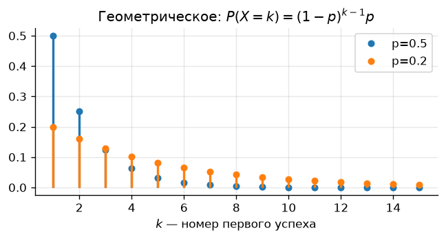
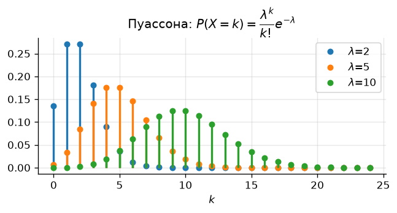
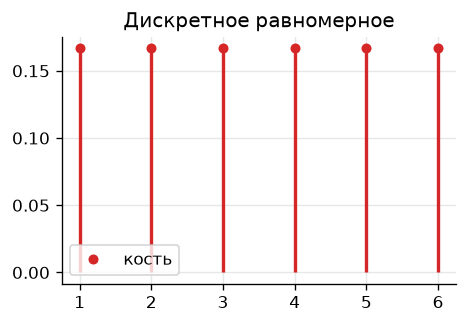
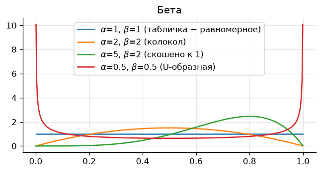
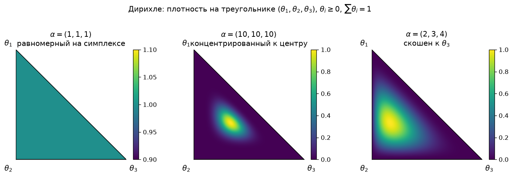

# Шпора: распределения

Сгенерированные графики: `figures/*.png` (пересоздать — `scripts/gen_distribution_figures.py`).

## Быстрая навигация

**Дискретные** (считаем количество): Бернулли, биномиальное, геометрическое, гипергеометрическое, Пуассона, мультиномиальное (и категориальное), дискретное равномерное.

**Непрерывные** (измерения, время): равномерное, нормальное, экспоненциальное, гамма, бета, Дирихле.

| Распределение | Параметры | $E$ | $\operatorname{Var}$ |
|---|---|---|---|
| Бернулли$(p)$ | $p \in [0,1]$ | $p$ | $p(1-p)$ |
| Биномиальное$(n,p)$ | $n \ge 1$, $p$ | $np$ | $np(1-p)$ |
| Геометрическое$(p)$ | $p$ | $1/p$ | $(1-p)/p^2$ |
| Гипергеом.$(N,K,n)$ | совокупность $N$, успехов $K$, выборка $n$ | $n\frac{K}{N}$ | $n\frac{K}{N}(1{-}\frac{K}{N})\frac{N-n}{N-1}$ |
| Пуассона$(\lambda)$ | $\lambda > 0$ | $\lambda$ | $\lambda$ |
| Мультиномиальное$(n, \mathbf{p})$ | $p_1 + \dots + p_m = 1$ | $E X_i = np_i$ | $\operatorname{Var} X_i = np_i(1-p_i)$, $\operatorname{Cov}(X_i, X_j) = -np_ip_j$ |
| Дискр. равномерное на $\{1,\dots,n\}$ | $n$ | $\frac{n+1}{2}$ | $\frac{n^2-1}{12}$ |
| Равномерное на $[a,b]$ | $a < b$ | $\frac{a+b}{2}$ | $\frac{(b-a)^2}{12}$ |
| Нормальное$(\mu, \sigma^2)$ | $\mu \in \mathbb{R}$, $\sigma > 0$ | $\mu$ | $\sigma^2$ |
| Экспоненциальное$(\lambda)$ | $\lambda > 0$ | $1/\lambda$ | $1/\lambda^2$ |
| Гамма$(k, \theta)$ | $k > 0$, $\theta > 0$ | $k\theta$ | $k\theta^2$ |
| Бета$(\alpha, \beta)$ | $\alpha, \beta > 0$ | $\frac{\alpha}{\alpha+\beta}$ | $\frac{\alpha\beta}{(\alpha+\beta)^2(\alpha+\beta+1)}$ |
| Дирихле$(\boldsymbol\alpha)$ | $\alpha_i > 0$, $\alpha_0 = \sum \alpha_i$ | $E\theta_i = \frac{\alpha_i}{\alpha_0}$ | $\operatorname{Var}\theta_i = \frac{\alpha_i(\alpha_0-\alpha_i)}{\alpha_0^2(\alpha_0+1)}$, $\operatorname{Cov}(\theta_i,\theta_j) = -\frac{\alpha_i\alpha_j}{\alpha_0^2(\alpha_0+1)}$ |

---

## Дискретные распределения

### Бернулли$(p) — одно испытание «успех/неудача»
- **Закон:** $P(X=1) = p$, $P(X=0) = 1-p$.
- **Когда:** любой одиночный двоичный исход (клик/не клик, орёл/решка).
- 
- **Связи:** сумма $n$ независимых Бернулли$(p)$ = биномиальное$(n,p)$.

### Биномиальное$(n,p)$ — число успехов за $n$ испытаний
- **Закон:** $P(X=k) = C_n^k p^k (1-p)^{n-k}$, $k = 0, \dots, n$.
- **Когда:** фиксированное число независимых испытаний **с возвращением**; считаем успехи.
- 
- **Свойства:** $X = X_1 + \dots + X_n$ (сумма Бернулли); при больших $n$ ≈ нормальное $(np, np(1-p))$; при большом $n$ и малом $p$ ($np \to \lambda$) ≈ Пуассона$(\lambda)$.

### Геометрическое$(p)$ — номер первого успеха
- **Закон:** $P(X=k) = (1-p)^{k-1} p$, $k = 1, 2, \dots$ (нумерация с 1!).
- **Когда:** повторяем испытания **до первого успеха**.
- 
- **Свойства:** $E = 1/p$; отсутствие памяти: $P(X > m + n \mid X > m) = P(X > n)$. Внимание к конвенции: если $X$ — число неудач до первого успеха, то $E = (1-p)/p$.

### Гипергеометрическое$(N, K, n)$ — успехи в выборке без возвращения
- **Закон:** $P(X=k) = \dfrac{C_K^k\, C_{N-K}^{n-k}}{C_N^n}$.
- **Когда:** из конечной совокупности ($N$ элементов, $K$ «успехов») тянем $n$ **без возвращения**; A/B-тесты, контроль качества, тест Фишера.
- 
- **Связь:** при $N \to \infty$ вырождается в биномиальное$(n, K/N)$ (возвращение почти ничего не меняет).

### Пуассона$(\lambda)$ — счёт редких событий
- **Закон:** $P(X=k) = \dfrac{\lambda^k}{k!} e^{-\lambda}$, $k = 0, 1, 2, \dots$
- **Когда:** число событий за фиксированный интервал времени/объёма при постоянной интенсивности (звонки за час, опечатки на страницу); «большое $n$, малое $p$».
- 
- **Свойства:** $E = \operatorname{Var} = \lambda$ (одна константа — легко узнать); сумма независимых пуассоновских = Пуассона с суммой $\lambda$.

### Мультиномиальное$(n, p_1, \dots, p_m)$ — счёт по категориям
- **Закон:** $P(X_1 = k_1, \dots, X_m = k_m) = \dfrac{n!}{k_1! \cdots k_m!} p_1^{k_1} \cdots p_m^{k_m}$, $\sum k_i = n$.
- **Когда:** $n$ независимых испытаний с $m$ исходами (кости, категории текстов); категориальное = одно такое испытание.
- **Связи:** маргиналы биномиальные; в байесовской модели — правдоподобие для счётов слов/классов.

### Дискретное равномерное — «честная кость»
- **Закон:** $P(X=k) = 1/n$, $k = 1, \dots, n$.
- 

---

## Непрерывные распределения

### Равномерное на $[a, b]$
- **Плотность:** $f(x) = \dfrac{1}{b-a}$ на $[a,b]$, иначе $0$.
- **Когда:** «всё в интервале равновозможно»; геометрическая вероятность.
- 

### Нормальное$(\mu, \sigma^2)$
- **Плотность:** $f(x) = \dfrac{1}{\sigma\sqrt{2\pi}} e^{-\frac{(x-\mu)^2}{2\sigma^2}}$.
- **Когда:** сумма многих независимых мелких вкладов (ЦПТ); погрешности измерений; базовая модель шума.
- 
- **Свойства:** стандартизация $Z = \frac{X-\mu}{\sigma} \sim \mathcal{N}(0,1)$; правило $68\%–95\%–99{,}7\%$ для $1\sigma, 2\sigma, 3\sigma$; сумма независимых нормальных = нормальная; обозначение $\varphi$ — плотность, $\Phi$ — функция распределения стандартной нормали.

### Экспоненциальное$(\lambda)$ — время до первого события
- **Плотность:** $f(x) = \lambda e^{-\lambda x}$, $x \ge 0$.
- **Когда:** время между событиями пуассоновского потока; время до отказа «без старения».
- 
- **Свойства:** отсутствие памяти (непрерывный аналог геометрического); $\min$ независимых экспоненциальных с интенсивностями $\lambda_i$ = экспоненциальное с $\lambda = \sum \lambda_i$; частный случай гаммы ($k=1$).

### Гамма$(k, \theta)$ — время до $k$-го события
- **Плотность:** $f(x) = \dfrac{x^{k-1} e^{-x/\theta}}{\Gamma(k)\,\theta^k}$, $x \ge 0$; $\Gamma(n) = (n-1)!$ для целых $n$.
- **Когда:** сумма $k$ независимых экспоненциальных$(\lambda = 1/\theta)$; время до $k$-го события потока; «изогнутое» неотрицательное распределение с двумя параметрами.
- 
- **Свойства:** $k$ — форма (насколько «колокольная»), $\theta$ — масштаб (растяжение по оси); при целых $k$ называется распределением Эрланга.

### Бета$(\alpha, \beta)$ — распределение вероятности/доли
- **Плотность:** $f(x) = \dfrac{x^{\alpha-1}(1-x)^{\beta-1}}{B(\alpha, \beta)}$ на $[0,1]$, где $B(\alpha, \beta) = \dfrac{\Gamma(\alpha)\Gamma(\beta)}{\Gamma(\alpha+\beta)}$.
- **Когда:** неизвестная вероятность успеха $p$ (CTR, частота); априорное распределение в байесовском выводе.
- 
- **Формы:** $(1,1)$ — равномерное; $\alpha, \beta > 1$ — колокол, мода $\frac{\alpha-1}{\alpha+\beta-2}$; $\alpha, \beta < 1$ — U-образная (масса у краёв); $\alpha = \beta$ — симметрия.
- **Сопряжённость (ключ для ML):** априор $\mathrm{Beta}(\alpha, \beta)$ + данные «$k$ успехов из $n$ испытаний Бернулли» → апостериор $\mathrm{Beta}(\alpha + k,\; \beta + n - k)$. Параметры читаются как «псевдосчёты»: априор $(\alpha, \beta) = (1, 1)$ = «ни одного наблюдения». Апостериорное среднее: $\frac{\alpha + k}{\alpha + \beta + n}$.

### Дирихле$(\boldsymbol\alpha = \alpha_1, \dots, \alpha_m)$ — распределение набора долей
- **Носитель:** симплекс $\theta_i \ge 0$, $\sum \theta_i = 1$.
- **Плотность:** $f(\boldsymbol\theta) = \dfrac{1}{\Delta(\boldsymbol\alpha)} \prod_{i=1}^m \theta_i^{\alpha_i - 1}$, где $\Delta(\boldsymbol\alpha) = \prod \Gamma(\alpha_i) / \Gamma(\alpha_0)$, $\alpha_0 = \sum \alpha_i$.
- **Когда:** неизвестный вектор вероятностей категорий (веса тем в документе, вероятности слов); априор для мультиномиального.
- 
- **Чтение параметров:** $E\theta_i = \alpha_i / \alpha_0$ — «центр» задаётся пропорциями $\alpha_i$; концентрация $\alpha_0$ — насколько вектор зажат возле центра (ср. $(10,10,10)$ и $(2,3,4)$ на графике); $(1, \dots, 1)$ — равномерное на симплексе; $\alpha_i < 1$ — масса у рёбер/вершин.
- **Свойства:** маргинальное $\theta_i \sim \mathrm{Beta}(\alpha_i, \alpha_0 - \alpha_i)$; бета — частный случай ($m = 2$); сопряжённый априор мультиномиального: априор $\boldsymbol\alpha$ + счёты $\mathbf{k}$ → апостериор $\boldsymbol\alpha + \mathbf{k}$. Основа LDA и наивного Байеса с байесовским сглаживанием.
