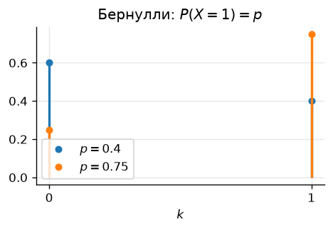
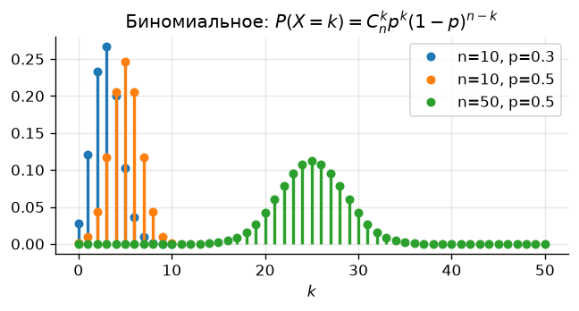
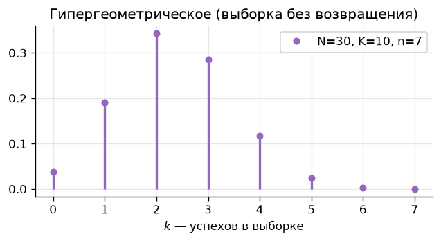
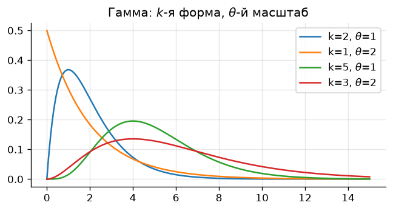
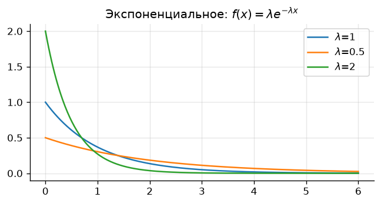
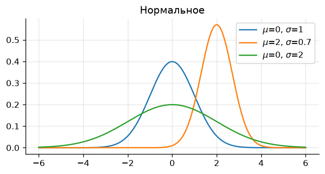
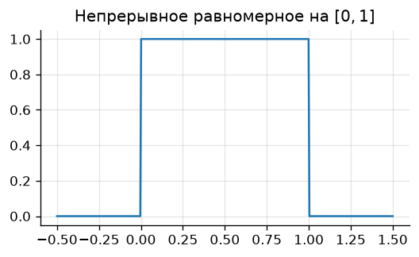

# Шпора: распределения

Порядок: дискретные → непрерывные; внутри — по «вытеканию»: сначала то, что обобщает, затем его частные случаи и производные.
Каждая карточка — кратко всё про одно распределение. Графики: `figures/*.png` (перегенерация — `scripts/gen_distribution_figures.py`).

---

# Дискретные

## 1. Мультиномиальное$(n; p_1, \dots, p_m)$ — вершина дискретных
- **Что это:** счёт по категориям за $n$ независимых испытаний: вектор $(X_1, \dots, X_m)$, $\sum X_i = n$.
- **Закон:** $P(X_1{=}k_1, \dots, X_m{=}k_m) = \dfrac{n!}{k_1! \cdots k_m!}\, p_1^{k_1} \cdots p_m^{k_m}$, где $p_1 + \dots + p_m = 1$, $\sum k_i = n$.
- **Характеристики:** $E X_i = np_i$; $D X_i = np_i(1-p_i)$; $\mathrm{Cov}(X_i, X_j) = -np_i p_j$ (счёты «тянут» друг друга вниз из-за фиксированной суммы).
- **Когда возникает:** $n$ бросков кости, категории текстов, счёты классов/слов в наивном Байесе.
- **Кого порождает:** частный случай $n=1$ → категориальное; маргинал $X_i$ → биномиальное.
- **Сопряжённость:** априор — Дирихле (см. непрерывные): апостериор $\mathrm{Dir}(\boldsymbol\alpha + \mathbf{k})$.

## 2. Категориальное$(p_1, \dots, p_m)$ — одно испытание с $m$ исходами
- **Что это:** мультиномиальное с $n = 1$; результат — одна категория.
- **Закон:** $P(X = i) = p_i$, $i = 1, \dots, m$.
- **Характеристики:** $E X = i$-зависим (лучше работать с вектором счётов); для индикаторов $I_i = \mathbf{1}[X = i]$: $E I_i = p_i$, $D I_i = p_i(1-p_i)$.
- **Когда возникает:** один бросок кости, один шард/класс/тег.
- **Кого порождает:** при $m = 2$ → Бернулли; при равных $p_i$ → дискретное равномерное.

## 3. Бернулли$(p)$ — атом: успех/неудача
- **Что это:** одно испытание с двумя исходами.
- **Закон:** $P(X=1) = p$, $P(X=0) = 1-p$.
- **Характеристики:** $E = p$; $D = p(1-p)$.
- **Когда возникает:** клик/не клик, попадание/промах.
- 
- **Кого порождает:** сумма $n$ независимых → биномиальное; серия до первого успеха → геометрическое.

## 4. Биномиальное$(n, p)$ — успехов за $n$ испытаний
- **Что это:** $X = X_1 + \dots + X_n$, сумма $n$ независимых Бернулли$(p)$; маргинал мультиномиального.
- **Закон:** $P(X=k) = C_n^k p^k (1-p)^{n-k}$, $k = 0, \dots, n$.
- **Характеристики:** $E = np$; $D = np(1-p)$.
- **Когда возникает:** фиксированное число независимых испытаний **с возвращением** (или совокупность огромна).
- 
- **Пределы:** $n \to \infty$, $p$ мало, $np \to \lambda$ → Пуассона$(\lambda)$; $n$ велико → нормальное$(np, np(1-p))$.
- **Родня:** «то же без возвращения» → гипергеометрическое.

## 5. Гипергеометрическое$(N, K, n)$ — биномиальное без возвращения
- **Что это:** успехов в выборке объёма $n$ из конечной совокупности ($N$ элементов, $K$ успехов), без возвращения.
- **Закон:** $P(X=k) = \dfrac{C_K^k\, C_{N-K}^{n-k}}{C_N^n}$.
- **Характеристики:** $E = n\frac{K}{N}$; $D = n\frac{K}{N}(1-\frac{K}{N})\frac{N-n}{N-1}$ (множитель $\frac{N-n}{N-1} < 1$ — поправка на конечность).
- **Когда возникает:** контроль качества, карточные задачи, A/B-тест при фиксированных краевых суммах → точный тест Фишера, p-value.
- 
- **Предел:** $N \to \infty$ → биномиальное$(n, K/N)$.

## 6. Пуассона$(\lambda)$ — счёт редких событий
- **Что это:** предел биномиального при «много испытаний, мало шансов»; счёт событий потока за фиксированный интервал.
- **Закон:** $P(X=k) = \dfrac{\lambda^k}{k!} e^{-\lambda}$, $k = 0, 1, 2, \dots$
- **Характеристики:** $E = D = \lambda$ (одна константа — визитная карточка).
- **Когда возникает:** звонки за час, опечатки на страницу, клики на баннер; «большое $n$, малое $p$».
- 
- **Свойства:** сумма независимых пуассоновских → Пуассона$(\sum \lambda_i)$; время между событиями → экспоненциальное.

## 7. Геометрическое$(p)$ — испытания до первого успеха
- **Что это:** номер первого успеха в серии Бернулли.
- **Закон:** $P(X=k) = (1-p)^{k-1} p$, $k = 1, 2, \dots$ (нумерация с 1).
- **Характеристики:** $E = 1/p$; $D = (1-p)/p^2$. Внимание: если считать «число неудач до успеха», $E = (1-p)/p$.
- **Когда возникает:** «сколько попыток, пока…».
- 
- **Свойства:** отсутствие памяти: $P(X > m+n \mid X > m) = P(X > n)$; непрерывный двойник → экспоненциальное.

## 8. Дискретное равномерное — «честная кость»
- **Что это:** категориальное с равными $p_i = 1/n$.
- **Закон:** $P(X=k) = 1/n$, $k = 1, \dots, n$.
- **Характеристики:** $E = \frac{n+1}{2}$; $D = \frac{n^2-1}{12}$.
- 

---

# Непрерывные

## 9. Гамма$(k, \theta)$ — время до $k$-го события
- **Что это:** сумма $k$ независимых экспоненциальных$(\lambda = 1/\theta)$; обобщает экспоненциальное ($k = 1$).
- **Закон:** $f(x) = \dfrac{x^{k-1} e^{-x/\theta}}{\Gamma(k)\,\theta^k}$, $x \ge 0$; $\Gamma(n) = (n-1)!$ для целых $n$.
- **Характеристики:** $E = k\theta$; $D = k\theta^2$. $k$ — форма (насколько «колокольная»), $\theta$ — масштаб (растяжение оси).
- **Когда возникает:** время до $k$-го отказа/звонка; гибкая неотрицательная модель с двумя параметрами.
- 
- **Родня:** при целых $k$ — Эрланг; через гамму-функцию устроены бета и Дирихле.

## 10. Экспоненциальное$(\lambda)$ — время до первого события
- **Что это:** гамма с $k = 1$, $\theta = 1/\lambda$; время между событиями пуассоновского потока.
- **Закон:** $f(x) = \lambda e^{-\lambda x}$, $x \ge 0$.
- **Характеристики:** $E = 1/\lambda$; $D = 1/\lambda^2$. $\lambda$ — интенсивность (событий в единицу времени), а не среднее!
- **Когда возникает:** время до отказа «без старения», время между звонками.
- 
- **Свойства:** отсутствие памяти (двойник геометрического); $\min$ независимых экспоненциальных$(\lambda_i)$ → экспоненциальное$(\sum \lambda_i)$.

## 11. Нормальное$(\mu, \sigma^2)$
- **Что это:** предел суммы многих независимых мелких вкладов (ЦПТ); предел биномиального при большом $n$.
- **Закон:** $f(x) = \dfrac{1}{\sigma\sqrt{2\pi}} e^{-\frac{(x-\mu)^2}{2\sigma^2}}$.
- **Характеристики:** $E = \mu$; $D = \sigma^2$. Стандартизация $Z = \frac{X-\mu}{\sigma} \sim \mathcal{N}(0,1)$; обозначения: $\varphi$ — плотность, $\Phi$ — CDF стандартной нормали.
- **Когда возникает:** погрешности измерений, шум, агрегаты; «среднее и разброс известны».
- 
- **Свойства:** правило $68\%$–$95\%$–$99{,}7\%$ ($1\sigma, 2\sigma, 3\sigma$); сумма независимых нормальных → нормальная; линейные комбинации любых нормальных — нормальные.

## 12. Дирихле$(\boldsymbol\alpha = \alpha_1, \dots, \alpha_m)$ — вектор долей
- **Что это:** распределение на симплексе $\theta_i \ge 0$, $\sum \theta_i = 1$; обобщает бету ($m = 2$); сопряжённый априор мультиномиального.
- **Закон:** $f(\boldsymbol\theta) = \dfrac{1}{\Delta(\boldsymbol\alpha)} \prod_i \theta_i^{\alpha_i - 1}$, $\Delta(\boldsymbol\alpha) = \prod_i \Gamma(\alpha_i) / \Gamma(\alpha_0)$, $\alpha_0 = \sum \alpha_i$.
- **Характеристики:** $E\theta_i = \alpha_i/\alpha_0$; $D\theta_i = \frac{\alpha_i(\alpha_0 - \alpha_i)}{\alpha_0^2(\alpha_0+1)}$; $\mathrm{Cov}(\theta_i, \theta_j) = -\frac{\alpha_i\alpha_j}{\alpha_0^2(\alpha_0+1)}$.
- **Чтение параметров:** пропорции $\alpha_i$ задают центр, $\alpha_0$ — концентрацию (зажатость возле центра); $(1, \dots, 1)$ — равномерное на симплексе; $\alpha_i < 1$ — масса у рёбер/вершин.
- **Когда возникает:** неизвестные вероятности категорий: веса тем в LDA, вероятности слов; сглаживание в наивном Байесе.
- 
- **Сопряжённость:** априор $\boldsymbol\alpha$ + счёты $\mathbf{k}$ → апостериор $\mathrm{Dir}(\boldsymbol\alpha + \mathbf{k})$; псевдосчёты. Маргинал $\theta_i \sim \mathrm{Beta}(\alpha_i, \alpha_0 - \alpha_i)$.

## 13. Бета$(\alpha, \beta)$ — случайная вероятность/доля
- **Что это:** Дирихле при $m = 2$; распределение величины из $[0,1]$ — «вероятность вероятности».
- **Закон:** $f(x) = \dfrac{x^{\alpha-1}(1-x)^{\beta-1}}{B(\alpha, \beta)}$ на $[0,1]$, $B(\alpha, \beta) = \dfrac{\Gamma(\alpha)\Gamma(\beta)}{\Gamma(\alpha+\beta)}$.
- **Характеристики:** $E = \frac{\alpha}{\alpha+\beta}$; $D = \frac{\alpha\beta}{(\alpha+\beta)^2(\alpha+\beta+1)}$; мода (при $\alpha, \beta > 1$) $= \frac{\alpha-1}{\alpha+\beta-2}$.
- **Формы:** $(1,1)$ — равномерное; $\alpha, \beta > 1$ — колокол; $\alpha, \beta < 1$ — U-образная; $\alpha = \beta$ — симметрия.
- **Когда возникает:** неизвестный CTR/доля; априор для байесовского вывода о вероятности успеха.
- 
- **Сопряжённость:** априор $\mathrm{Beta}(\alpha, \beta)$ + «$k$ успехов из $n$» → апостериор $\mathrm{Beta}(\alpha + k, \beta + n - k)$; псевдосчёты, апостериорное среднее $\frac{\alpha+k}{\alpha+\beta+n}$. Сравнение двух CTR: $P(\mathrm{CTR}_A > \mathrm{CTR}_B)$ через апостериорные беты.

## 14. Непрерывное равномерное на $[a, b]$
- **Что это:** бета$(1,1)$, растянутая на $[a,b]$; «всё в интервале равновозможно».
- **Закон:** $f(x) = \frac{1}{b-a}$ на $[a,b]$, иначе $0$.
- **Характеристики:** $E = \frac{a+b}{2}$; $D = \frac{(b-a)^2}{12}$.
- **Когда возникает:** геометрическая вероятность, «точка наудачу на отрезке».
- 
